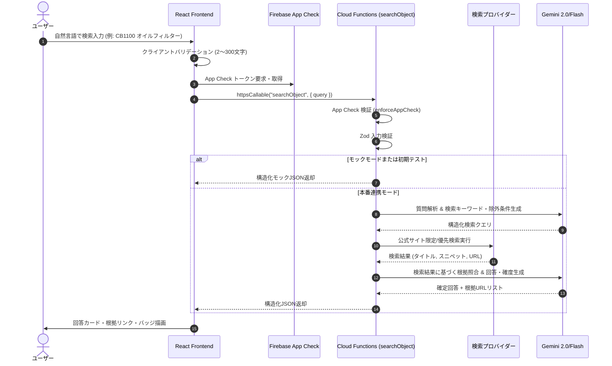

# アーキテクチャ設計書 (docs/ARCHITECTURE.md)

## 1. 全体アーキテクチャ概要

本システムは、ブラウザと外部AI/検索APIを完全に隔離し、Firebaseのマネージドセキュリティ機構を介してセキュアに連携する構成をとります。

```
+-------------------------------------------------------------+
|                      User Browser                           |
|  - React 18 / Vite SPA (TypeScript)                         |
|  - UI: チャット形式・回答カード表示                          |
|  - Firebase SDK (App Check Token 取得 & Callable 関数呼び出し)|
+------------------------------+------------------------------+
                               |
                               | HTTPS (App Check Token 付与)
                               v
+-------------------------------------------------------------+
|                  Firebase Hosting (CDN)                     |
|  - 静的アセット配信 (index.html, JS, CSS)                   |
|  - セキュリティレスポンスヘッダー付与 (CSP, HSTS, etc.)     |
+-------------------------------------------------------------+
                               |
                               v
+-------------------------------------------------------------+
|        Firebase App Check (reCAPTCHA v3 / Play Integrity)   |
|  - 未承認ドメイン・ボットからのリクエストを拒否             |
+------------------------------+------------------------------+
                               | 検証通過
                               v
+-------------------------------------------------------------+
|         Cloud Functions 2nd gen (Node.js 20/22 / TS)        |
|  - リージョン: asia-northeast1 (東京)                        |
|  - エントリーポイント: Callable Function `searchObject`     |
|  - 制限: maxInstances: 3, timeout: 60s, memory: 512MB      |
|  - 入力検証: Zod バリデータ                                 |
|  - シークレット管理: Google Cloud Secret Manager             |
+------------------------------+------------------------------+
                               |
            +------------------+------------------+
            | (サーバー側からのみ安全に呼び出し)     |
            v                                     v
+-----------------------+             +-----------------------+
|   外部 Web 検索 API    |             |       Gemini API      |
| (Google Custom Search |             | (解析・クエリ生成・   |
|   / Bing Web Search)  |             |  根拠照合・回答整形)  |
+-----------------------+             +-----------------------+
```

---

## 2. ディレクトリ構造

モノレポ構成としてプロジェクト全体を一元管理し、フロントエンドとバックエンドの境界を明確にします。

```
mono-finder-ai/
├── README.md                      # プロジェクト概要・導入手順
├── firebase.json                  # Hosting / Functions / Emulators 設定
├── .firebaserc                    # Firebase プロジェクト設定
├── .gitignore                     # Git 除外設定 (秘密情報、dist、node_modules)
├── docs/
│   ├── SPEC.md                    # 仕様書
│   ├── ARCHITECTURE.md            # アーキテクチャ設計書（本書）
│   └── SECURITY.md                # セキュリティ規定・ガイドライン
│
├── frontend/                      # フロントエンド (React + Vite + TypeScript)
│   ├── index.html
│   ├── vite.config.ts
│   ├── package.json
│   ├── tsconfig.json
│   ├── public/
│   └── src/
│       ├── main.tsx
│       ├── App.tsx                # メインUI・チャットフロー制御
│       ├── index.css              # スタイル定義 (Tailwind風モダンCSS)
│       ├── components/
│       │   ├── Header.tsx         # タイトル・モード表示
│       │   ├── SearchInput.tsx    # 入力フォーム（バリデーション・注意書き）
│       │   ├── ResultCard.tsx     # 構造化回答カード
│       │   ├── SourceBadge.tsx    # 情報源種別バッジ（メーカー公式、PDF等）
│       │   ├── ConfidenceBadge.tsx# 確度表示（高・中・低・不明）
│       │   └── Disclaimer.tsx     # 免責事項・車両部品の注意点
│       ├── services/
│       │   ├── firebase.ts        # Firebase 初期化・App Check設定
│       │   ├── api.ts             # API 呼び出し抽象化レイヤー (Mock / Real)
│       │   └── mockData.ts        # ローカル動作用モック検索結果
│       └── types/
│           └── index.ts           # フロントエンド共通型定義
│
└── functions/                     # バックエンド (Cloud Functions 2nd gen)
    ├── package.json
    ├── tsconfig.json
    └── src/
        ├── index.ts               # Callable `searchObject` の定義
        ├── types.ts               # リクエスト/レスポンス型定義
        ├── validators.ts          # Zod バリデータ
        ├── mockService.ts         # サーバー側モック応答エンジン
        └── security.ts            # エラーサニタイズ・ヘッダー処理
```

---

## 3. レイヤー設計と責務分担

### 3.1 フロントエンド (`frontend/`)
- **責務**:
  - ユーザーからの自然言語入力の受付
  - クライアント側簡易バリデーション（2〜300文字、空文字判定）
  - App Check トークン取得と Callable Function への引継ぎ
  - レスポンスJSONの視覚的レンダリング（回答カード、根拠URL、信頼度バッジ）
  - 不足情報 (`needsMoreInformation`) に応じたフォローアップ質問の表示
- **禁止事項**:
  - AI API（Gemini等）や Web検索 API の直接呼出し
  - API キーや秘密情報の保持

### 3.2 サービス抽象化層 (`frontend/src/services/api.ts`)
- モード切り替えフラグ (`VITE_USE_MOCK=true/false`) により、ローカル開発時はバックエンド不要で完全なUI動作確認を可能にする。
- 本番・エミュレータ接続時は Firebase SDK の `httpsCallable` を呼び出す。

### 3.3 バックエンド (`functions/`)
- **責務**:
  - `onCall` (2nd gen) による認証・App Check トークン検証
  - Zod による厳密なスキーマ検証（型、文字数、制御文字除外）
  - 外部APIオーケストレーション（検索クエリ生成 → 検索実行 → 根拠評価 → JSON生成）
  - エラーのサニタイズ（内部スタックトレースや内部通信先をクライアントへ露出させない）
- **セキュリティ・リソース制限**:
  - リージョン: `asia-northeast1` (東京)
  - `maxInstances: 3` (DoS・コスト暴走を物理的に防ぐ初期設定)
  - `timeoutSeconds: 60`
  - `memory: "512MiB"`

---

## 4. 処理フローシーケンス



---

## 5. 開発マイルストーン (10フェーズ)

| フェーズ | 内容 | 達成基準 |
| :--- | :--- | :--- |
| **Phase 1** | **React UI を Mock データで動かす** | クライアント完結で入力〜回答カード表示まで快適に動作すること |
| **Phase 2** | **Firebase Hosting / Emulator 対応** | ローカルエミュレータ上でフロントエンドとHosting設定が動作すること |
| **Phase 3** | **Callable Cloud Functions 雛形作成** | `searchObject` のスケルトンがエミュレータで呼び出し可能なこと |
| **Phase 4** | **App Check と Zod 入力検証の導入** | 不正入力の拒否およびApp Checkトークンハンドリングの確立 |
| **Phase 5** | **検索プロバイダーの安全な接続** | Functionsからサーバーサイド限定で検索APIを呼び出せること |
| **Phase 6** | **AI による検索結果整理・クエリ生成** | プロンプトインジェクション対策とハルシネーション抑制の確立 |
| **Phase 7** | **根拠評価・複数ソース照合の実装** | 公式/PDF/販売サイトの分類判定と確度算出ロジックの実装 |
| **Phase 8** | **レート制限・コスト対策・セキュリティ検証** | maxInstances制限、タイムアウト、エラーサニタイズ等の総合監査 |
| **Phase 9** | **小規模な非公開テスト** | 特定テスター環境での動作検証とフィードバック収集 |
| **Phase 10** | **本番公開判定** | SECURITY.md の全チェックリスト完了後の本番デプロイ |
